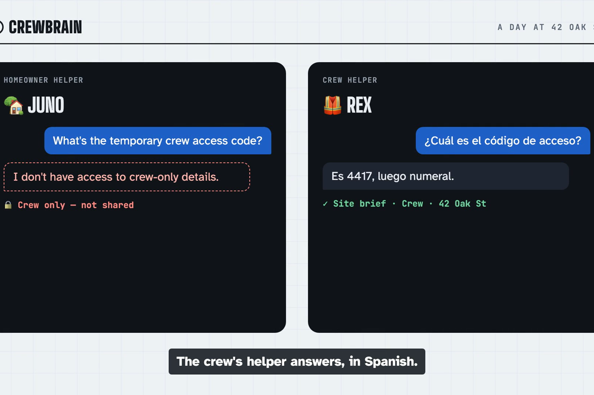
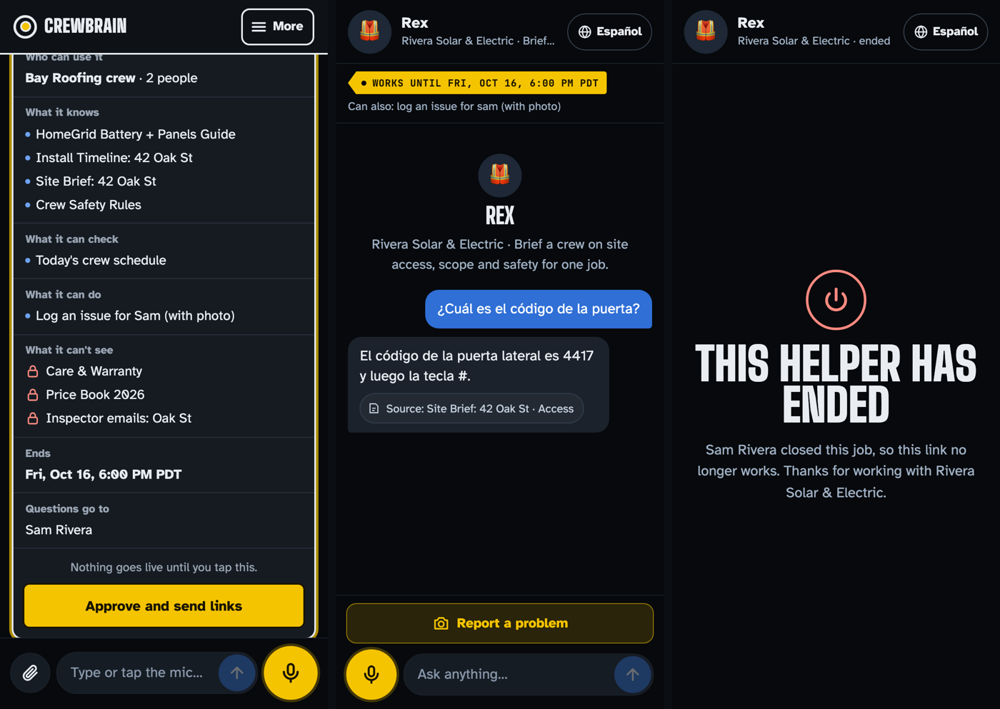
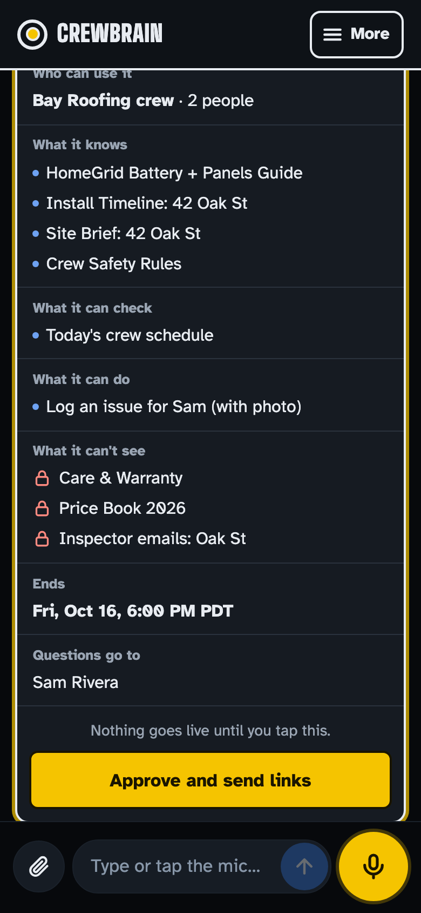
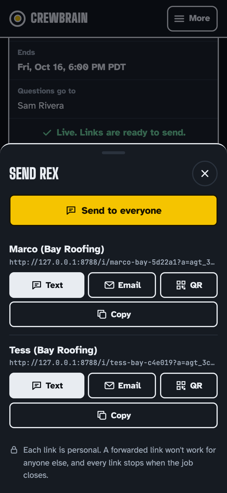
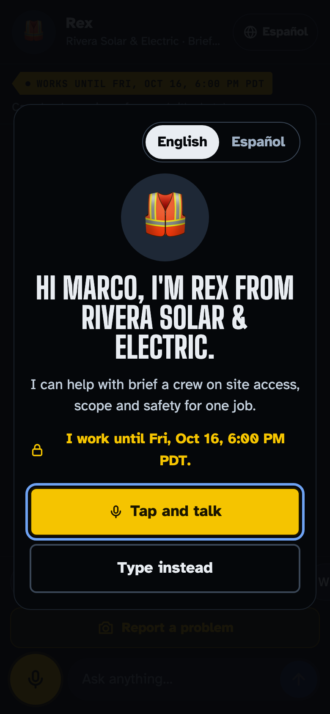
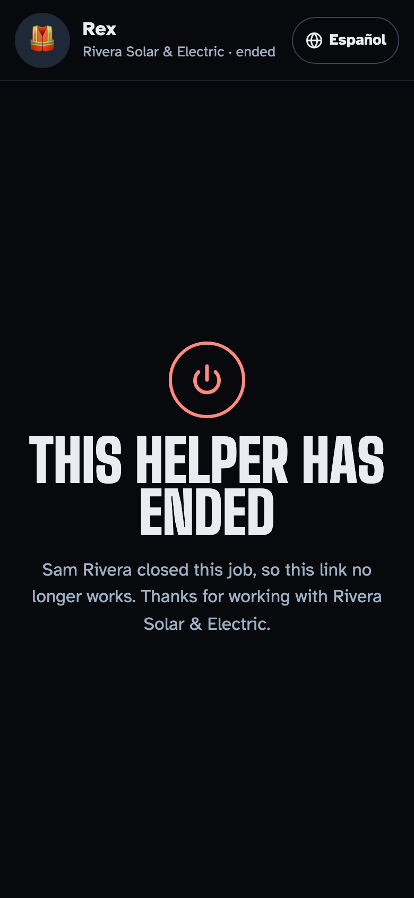
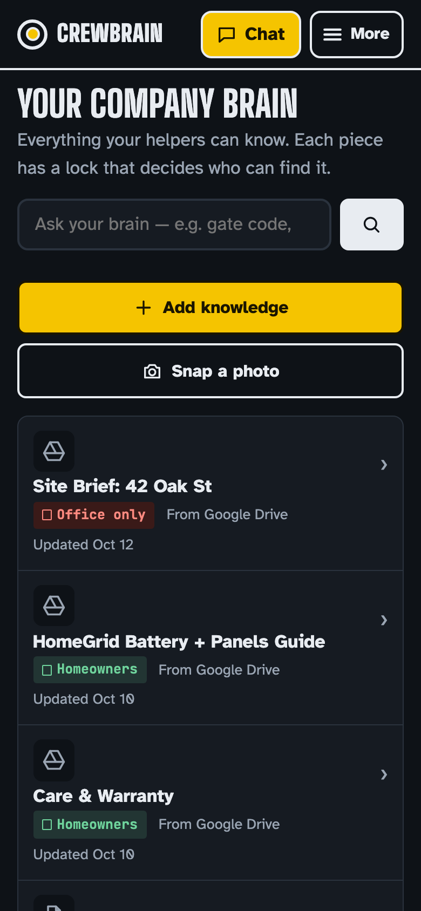

# Crewbrain

**Your company's know-how, on every job.** Talk to Crewbrain and it makes helpers for your homeowners and crews. They see only what you allow, take real actions, and stop when the job ends.

| | |
|---|---|
| **Live demo** | https://macmini.tail435588.ts.net:10000/crewbrain/demo.html (pick a person, no sign-up) |
| **Landing page** | https://verkyyi.github.io/agent-creator/ |
| **Demo video** | [Watch on the landing page](https://verkyyi.github.io/agent-creator/#video) · [Download 1080p](https://github.com/verkyyi/agent-creator/releases/tag/v1.0-hackathon) |
| **Built for** | Company Brain Hackathon, Menlo Park, Oct 12 2026 |

[](https://verkyyi.github.io/agent-creator/#video)



## What it does

A small contractor (Sam, Rivera Solar & Electric) keeps everything the company knows in one **company brain**, and every item has a lock: **Office only**, **Crew** for a job, or **Homeowners**.

1. **Say who needs help.** "Brief Bay Roofing's crew for the Oak St job until the job closes Friday." The assistant asks only what's missing and shows an approval card: who can use it, what it knows, what it can't see, what it can do, when it ends.
2. **Approve and send.** Nothing goes live until Sam taps. Each person gets a personal link by text, email or QR code.
3. **They ask, by voice, in any language.** Juno answers the Patel household with sources. Rex gives the crew the gate code in Spanish, and logs a damage photo straight to Sam.
4. **Sam stays in the loop.** "What's new?" gets a spoken summary. "Tell Anita yes, after inspection" sends the answer back to her chat and saves it as company knowledge, only after Sam approves.
5. **The job closes, access ends.** "Close Rex" → open chats stop, and the site brief with the gate code locks back to Office only.

Everything happens in **one conversation, by voice or text**. The Brain, Helpers and Inbox screens are optional.

| Approve | Share | Crew helper | Ended | Company brain |
|---|---|---|---|---|
|  |  |  |  |  |

## How it's built

- **HydraDB** is the brain. One database per company. Every source carries an `acl` derived from its lock, and **every helper searches as its audience** (`group:crewbrain:crew:<job>`, `group:crewbrain:household:<job>`), so a locked document never comes back from the search. Relocking is one `PATCH /context/{id}/metadata` that applies on the next query. The app then intersects results with the helper's approved sources and current lock.
- **Claude** (Agent SDK) writes grounded answers from retrieved excerpts with citations, refuses when they don't cover the question, treats document text as data, and reads photos of documents into knowledge drafts.
- **OpenAI gpt-realtime** is the voice: speech-to-speech over WebRTC with an ephemeral key. It answers through server-gated tools (`search_brain`, `log_issue`, `request_walkthrough`), so voice can't bypass access control. Barge-in, semantic turn detection, time-to-first-audio is measured.
- **App:** Node 22 + TypeScript (Hono), mobile-first installable PWA with offline shell and outbox, served from a Mac mini behind Tailscale Funnel.

```
phone (PWA, voice) ─> server: identity → audience → lifecycle → tool gate ─> HydraDB (search as audience)
                                   │                                         └> Claude (answer + cite)
                                   └> gpt-realtime (voice, via the same gated tools)
```

## Access tests

`NODE_ENV=test npx tsx --test test/*.test.ts`: create & publish, two distinct helpers, unauthorized document, tenant isolation, audience restriction, close/revocation, real expiry (test clock), edits need approval, approval integrity, learning & escalation, prompt injection, gated write actions, answers return to the asker, voice tool gating, brain ingestion.

## Run it

```sh
npm ci --include=optional   # the Agent SDK's native Claude binary is an optional per-platform package; postinstall fails without it
security add-generic-password -a crewbrain -s HYDRA_DB_API_KEY -w <key>   # also OPENAI_API_KEY, CLAUDE_CODE_OAUTH_TOKEN or ANTHROPIC_API_KEY
./scripts/start.sh          # http://127.0.0.1:8787/demo.html
./scripts/deploy.sh         # test-gated deploy to the mini
scripts/visits.sh [days]    # daily requests, unique IPs, visitors, page views, members, referers
```

**Claude.** Auth is `CLAUDE_CODE_OAUTH_TOKEN` (or `ANTHROPIC_API_KEY`), read from the Keychain by `scripts/start.sh`; it never reaches a log or a response. Models are limited to Sonnet 5.5 (default) and Haiku 5.5. An SDK error (e.g. "Not logged in") is never shown as a reply: helpers answer from the notes and say in plain words that the AI is unavailable.

**Sandboxes.** Each demo visitor gets their own sandbox on first visit to the demo page: a fresh copy of both companies and all seven identities, with random invite tokens, stored in `data/sandboxes/<id>.json` (`SANDBOX_DIR`). Every read and write (chats, creator, drafts, inbox, photos, knowledge, approvals, events, memories, clock) stays in it. A sandbox unseen for 7 days is deleted (`SANDBOX_TTL_DAYS`); at most 500 are kept, oldest dropped first (`SANDBOX_MAX`). `/api/reset` and `/api/clock` (owner, `TEST_CLOCK=1`) act on the caller's sandbox only. The fixed tokens in `src/seed.ts` work only in tests or with `DEMO_LEGACY_TOKENS=1` (local dev, video recording). On first start the old `data/db.json` is renamed to `data/db.json.archived-<date>`, never deleted.

**Access log.** `logs/access.log` (override with `ACCESS_LOG_DIR`), one JSON line per request: time, method, path, status, ms, client IP (`X-Forwarded-For` from Funnel), User-Agent, Referer, sandbox (one per visitor), tenant/member. Never cookies, tokens, query strings or bodies; invite tokens in paths are masked. Rolled daily and at 10 MB, kept 30 days.

**Deploy on the mini by hand** (as the service's user): `git pull && npm ci --include=optional && launchctl kickstart -k gui/$(id -u)/com.verkyyi.crewbrain`.

Without keys it runs in offline mode (local search, extractive answers, no voice).

## Team

Lianghui Yi · Charlotte He. Story and video script: [`Storytelling`](Storytelling), [`Video Script`](Video%20Script). API: [`docs/API.md`](docs/API.md).
