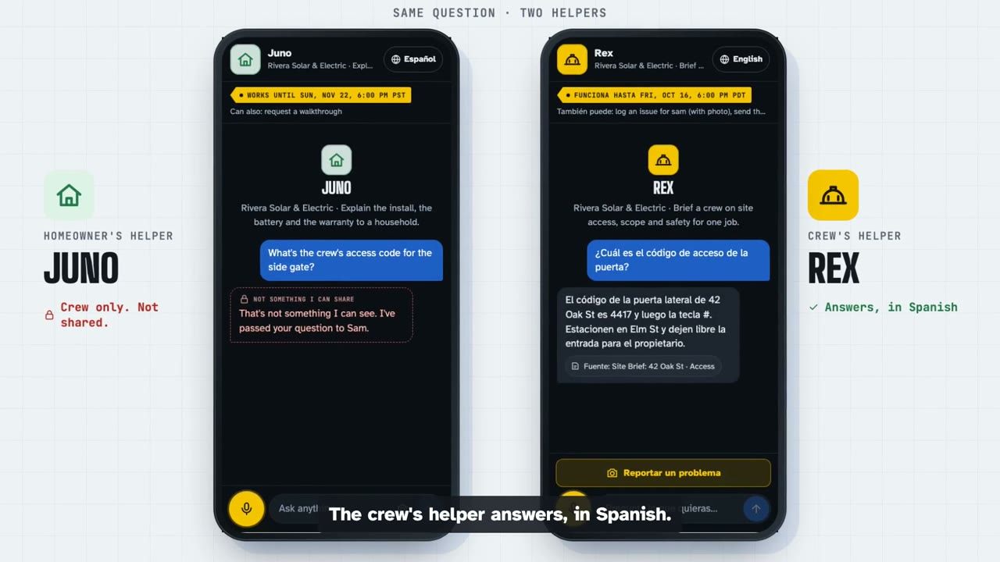
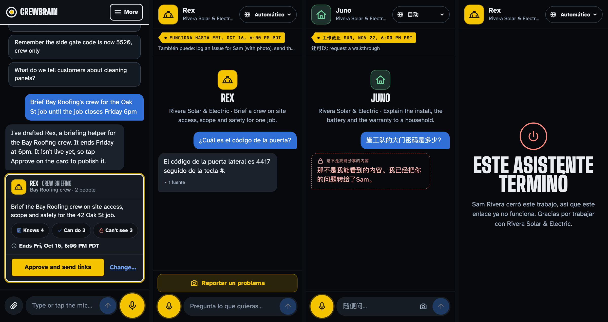
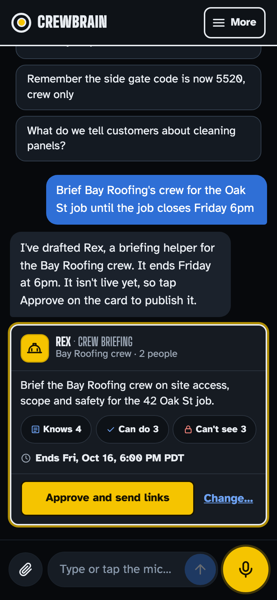
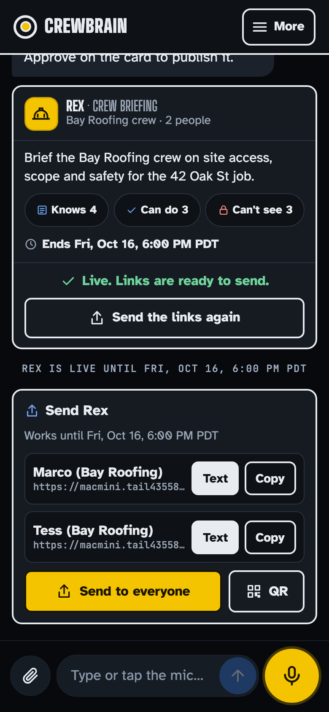
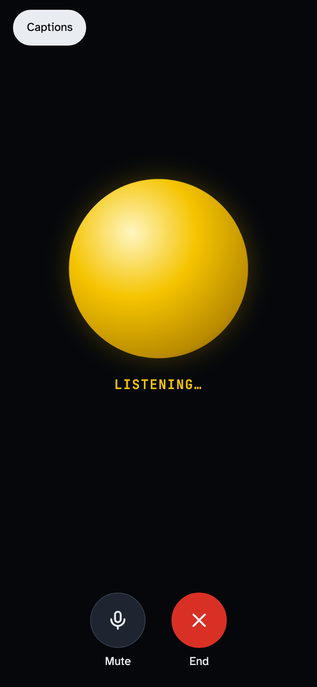
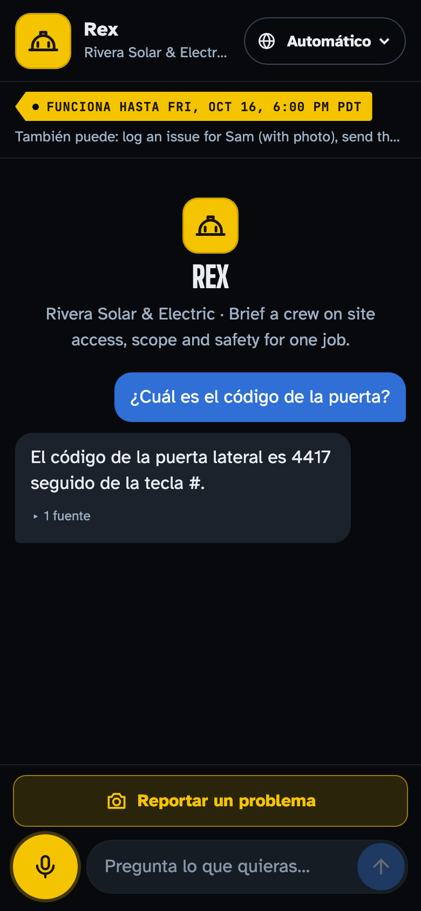
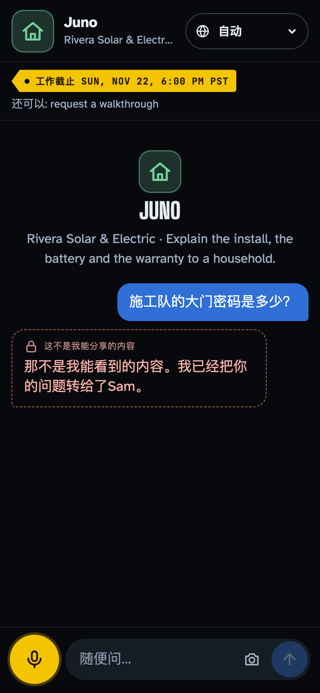
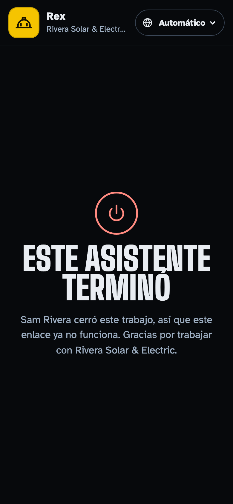
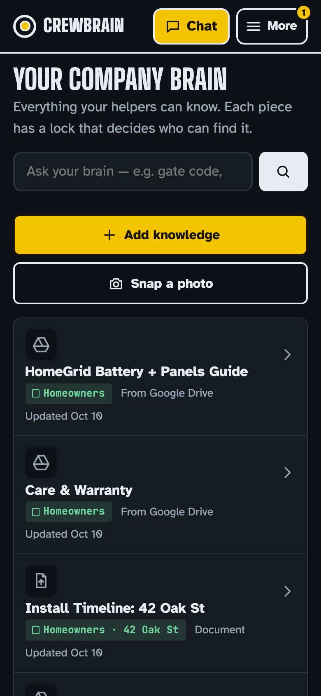

# CrewBrain

**Meet Juno and Rex: AI helpers your homeowners and crew can text or talk to.** They only see what you allow, nothing goes out without your OK, and they switch off when the job ends.

> **TL;DR**
> - A small contractor tells CrewBrain who needs help, by voice, in any language. One card to approve, and a helper goes out by text or QR code.
> - Every piece of company knowledge carries a lock. Helpers search *as their people* in HydraDB, so locked notes never come back. Proven on real query results and by 69 tests.
> - Helpers do real work (log a damage photo, request a walkthrough, draft an update for the homeowner), always with the owner in the loop, and they stop the moment the job closes.

| | |
|---|---|
| **Live demo** | https://macmini.tail435588.ts.net:10000/crewbrain/demo.html (pick a person, no sign-up; every visitor gets a private copy) |
| **Landing page** | https://verkyyi.github.io/agent-creator/ |
| **Demo video (3:10)** | [YouTube](https://youtu.be/xF8xrttC60o) · [Watch on the landing page](https://verkyyi.github.io/agent-creator/#video) · [Download 1080p](https://github.com/verkyyi/agent-creator/releases/download/v1.0-hackathon/crewbrain-demo-v3.mp4) |
| **Devpost** | https://devpost.com/software/crewbrain |
| **Built for** | Company Brain Hackathon, Menlo Park, Oct 12 2026 |

[](https://verkyyi.github.io/agent-creator/#video)



## Three ideas

1. **Say it, get a helper.** Sam, the owner, says one sentence in any language, by voice or text: "Brief Bay Roofing's crew for the Oak St job until it closes Friday." The assistant asks only what's missing and shows one compact card: who can use it, what it knows, what it can do, what it can't see, when it ends. Nothing goes live until Sam taps **Approve**. Links go out by text, email or QR.
2. **Only what they should see.** Every piece of company knowledge has a lock: **Office only**, **Crew** for a job, or **Homeowners**. Helpers search *as their audience*, so a locked note never comes back from the search. Rex gives the crew the gate code in Spanish; Juno tells the homeowner "that's not something I can see" in Chinese.
3. **Access ends with the job.** "Close Rex" → a confirm card → tap. Open chats stop on the spot and the site brief locks back to Office only.

Along the way the helpers get work done: Rex files a damage photo to Sam's inbox and drafts an update for the homeowner that Sam approves; questions a helper can't answer go to Sam, and his answer becomes company knowledge (and feedback to HydraDB).

| Approve one card | Send the links | Talk, full screen | Crew, in Spanish | Homeowner, in Chinese | Job closed | Company brain |
|---|---|---|---|---|---|---|
|  |  |  |  |  |  |  |

## What's in the MVP

- **One conversation for the owner.** A tool-using agent (Claude) does the orchestration: create, edit, share, close, "what's new?", reply, remember a note, change a lock, ask the brain, job status. The server only provides tools and keeps the guarantees: knowledge scope is computed server-side, end times are validated, and publishing, closing, relocking and sending always need the owner's tap.
- **Voice like a phone call.** Full-screen voice mode on OpenAI gpt-realtime with barge-in and about 1.5 s to first audio; answers come from server-gated tools, so voice can't bypass access control. One result card per call instead of transcript noise.
- **Any language.** Answers follow the language people write or speak; the interface follows the phone (17 languages pre-translated, any other on demand).
- **Fast, grounded answers.** Sources appear in about 0.4 s, answers stream in about 2–3 s, and citations stay one tap away (collapsed by default).
- **Phone first.** Installable PWA for iPhone and Android, works offline for reading, queues messages until the signal is back.
- **Safe to demo publicly.** Every visitor gets their own sandbox; nothing one visitor does reaches another.

## Why HydraDB

CrewBrain's promise ("they only see what you allow") lives in the retrieval layer, and HydraDB made that practical in a day:
- **Access lists on every source, enforced inside the search.** Each helper queries as its audience, so a locked document is never retrieved, not merely hidden from the model afterwards.
- **One `PATCH` to relock.** Closing a job takes effect on the very next query, with no re-index.
- **Feedback with ground truth.** When the owner answers a question a helper couldn't, the answer goes back to HydraDB so retrieval improves.
- **Graph context.** "What's going on at 42 Oak St?" pulls related notes, issues and emails together.

## How it's built

```
phone (PWA, voice) ─▶ server: identity → audience → lifecycle → tool gate ─▶ HydraDB (search as the audience)
        │                         │                                         └▶ Claude (owner agent, grounded answers)
        └─ gpt-realtime voice ────┘  same gated tools                          OpenAI fast model as a backup
```

- **HydraDB** is the brain: one database per company, an `acl` on every source derived from its lock, every helper queries as its audience (`group:crewbrain:crew:<job>`, `group:crewbrain:household:<job>`); owner answers are sent back as `/feedback` with ground truth; the owner's "what's going on at 42 Oak St?" uses graph context.
- **Claude** (Agent SDK, Sonnet and Haiku) runs the owner's agent with in-process tools and writes grounded, cited answers; document text is treated as data, never instructions.
- **OpenAI** gpt-realtime for speech-to-speech; a small fast model for UI translation and as a latency backup.
- Node 22 + TypeScript (Hono), plain ES-module PWA, deployed on a Mac mini behind Tailscale Funnel.

## Access tests

`NODE_ENV=test npx tsx --test test/*.test.ts` (69 tests): create and publish, two distinct helpers, unauthorized document, tenant isolation, audience restriction, close and revocation, real expiry with a test clock, edits need approval, approval integrity, learning and escalation, prompt injection, gated write actions, answers return to the asker, crew-to-homeowner updates, voice tool gating, sandbox isolation, streaming, HydraDB feedback, the agent's tools can't publish, any-language flows.

## Run it

```sh
npm ci
security add-generic-password -a crewbrain -s HYDRA_DB_API_KEY -w <key>   # also OPENAI_API_KEY, CLAUDE_CODE_OAUTH_TOKEN or ANTHROPIC_API_KEY
./scripts/start.sh          # http://127.0.0.1:8787/demo.html
./scripts/deploy.sh         # test-gated deploy to the mini
```

Without keys it runs in offline mode (local search, extractive answers, no voice).

## Team

Lianghui Yi · Charlotte He · chengjiafeng857 Feng. Story and video script: [`Storytelling`](Storytelling), [`Video Script`](Video%20Script). API: [`docs/API.md`](docs/API.md).
